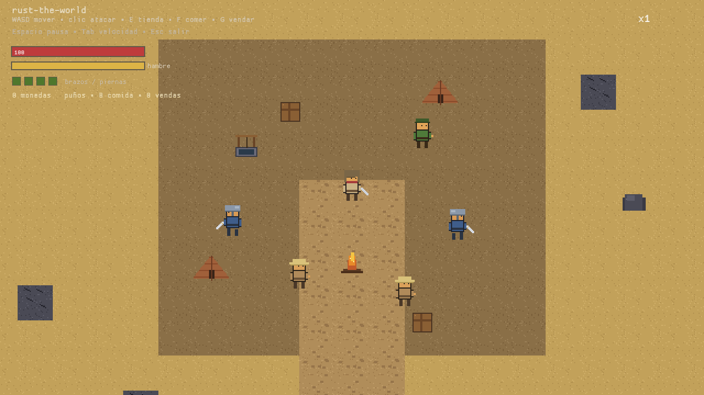

# rust-the-world

RPG 2D cenital en **Rust puro** (sin engine): eres un don nadie en un desierto hostil. Bandidos, guardias y alimañas se pelean entre sí; las heridas sangran, el hambre aprieta y la muerte es permanente.



## El bucle

Sales del pueblo con lo puesto, bajas por el camino al campamento de bandidos, peleas, saqueas los cuerpos, vuelves a vender el botín y compras comida y vendas. Si te caen, te desangras en el suelo.

- Combate en tiempo real con pausa y velocidad 1x/2x.
- Cuatro zonas de herida (brazos y piernas): cada una te quita daño o velocidad.
- Sangrado, hambre, caída y ejecución.
- IA faccional: un guardia y un bandido se matan solos si se cruzan.
- Agresión reactiva: si atacas a un civil, el pueblo entero te persigue.
- Muerte permanente: `R` reconstruye el mundo desde la semilla.

## Controles

| Tecla | Acción |
|---|---|
| `WASD` / flechas | Mover |
| Clic izquierdo | Atacar hacia el ratón |
| `E` | Abrir/cerrar tienda junto al mercader |
| `1` `2` `3` | Comprar comida / venda / vender arma de repuesto |
| `F` | Comer |
| `G` | Vendar |
| `Espacio` | Pausa |
| `Tab` | Velocidad 1x / 2x |
| `R` | Reiniciar al morir |
| `Esc` | Salir |

## Ejecutar

```bash
cargo run
cargo test
```

Captura del juego:

```bash
cargo run -- --shot docs/media/gameplay.png
```

## Arte

Todo el pixel art se genera con [`aseprite-asset-mcp`](https://github.com/jdsalasca/aseprite-asset-mcp) y queda versionado en `assets/art/`. Para regenerarlo:

```bash
node tools/paint_art.mjs
```

Requiere Aseprite instalado (`ASEPRITE_PATH` o la ruta de Steam por defecto).

## Estructura

```text
src/
  world.rs     mapa, tiles, colisión, A*
  actor.rs     stats, heridas, hambre, caída
  combat.rs    golpes, daño y ejecución
  ai.rs        facciones, agresión, patrulla y pathfinding
  economy.rs   botín, inventario y tienda
  game.rs      estado de la partida y reinicio
  render.rs    sprites y animaciones
  hud.rs       barras, log, tienda y muerte
  main.rs      bucle, cámara e input
```

Hecho con `macroquad` 0.4.
